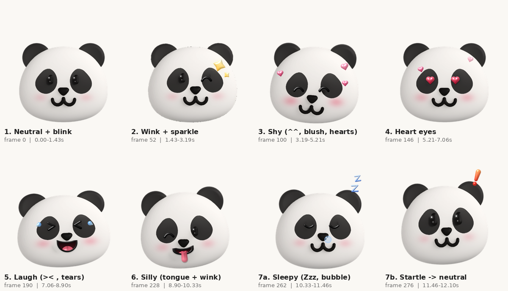

# studypanda-logo

Animated natural black-white panda.

## Expressive panda (12 s loop)

Seven scenes in one seamless loop: neutral + blink, wink, shy, heart eyes, laugh, silly tongue, sleepy -> startle.
288 frames at 42 ms (~23.8 fps), 12.1 s, transparent.

Files in `expressive/`: `panda_fun.png` (APNG 256), `panda_fun.webp`, `panda_fun.gif`, `panda_fun_512.png` (APNG 512), `panda_fun_512.webp`, `panda_fun_preview.mp4`, `preview_fun.png`.
